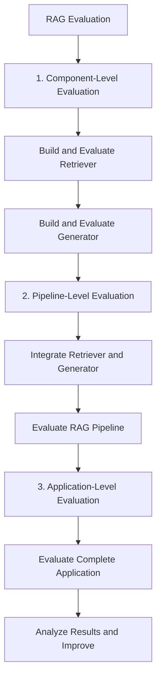

# RAG Evaluation

This project focuses on building and evaluating a **Retrieval-Augmented Generation (RAG)** application step by step. Instead of evaluating the entire system at once, each component is built and evaluated individually before moving to the complete pipeline and application.

## Evaluation Approach

The project follows three levels of evaluation:

1. **Component-Level Evaluation**
   - Build and evaluate the retriever.
   - Build and evaluate the generator.
   - Identify weaknesses in individual components.

2. **Pipeline-Level Evaluation**
   - Integrate the retriever and generator into a complete RAG pipeline.
   - Evaluate how well the components work together.

3. **Application-Level Evaluation**
   - Evaluate the complete RAG application from the user's perspective.
   - Analyze the overall quality and reliability of the responses.

## Project Workflow

The project follows a step-by-step evaluation approach, starting with individual components and progressing to the complete RAG application.

**Workflow summary:**

- **Component level:** Evaluate the retriever and generator separately.
- **Pipeline level:** Evaluate the integrated RAG pipeline.
- **Application level:** Evaluate the complete application and identify areas for improvement.

## Goal

The main goal is to understand the performance of each component, identify errors at different levels, and systematically improve the overall quality of the RAG application.

This repository is a work in progress. More details about the evaluation metrics, methodology, and results will be added as development continues.
